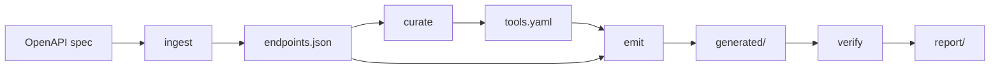

# Architecture

`mcp4api SPEC` runs four stages. Each stage reads the previous artifact and writes the next one.

Ingest normalizes OpenAPI 3.0, 3.1, 3.2, and Swagger 2.0 into one JSON Schema 2020-12 document. The same bytes produce the same `endpoints.json`. Curate's input hash covers those bytes, the criteria prompt, the model id, the `major.minor` version, and the curation flags. A patch or `rc` suffix does not change the hash. It does rewrite generated headers, which is why the sample check accepts `--update`.

A matching hash and no `--recurate` skips the model. The base manifest is `.mcp4api/base-tools.yaml` when that file's hash matches. Overrides are applied to that base on every run.

Emit writes `generated/` and `.mcp4api-files.json`, a digest of each file it wrote. A later emit refuses to overwrite a file whose digest changed. `--force` overwrites it. The published schemas are generated from the in-repo `ApiSpec`, `Manifest`, and `Report` models. Generated Python headers carry the source digest and a `# noqa: E501` so the long line stays one line.
