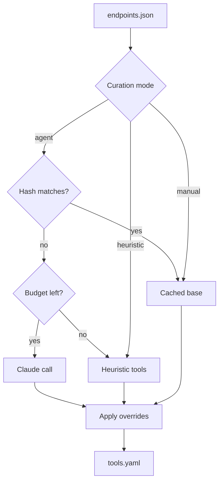
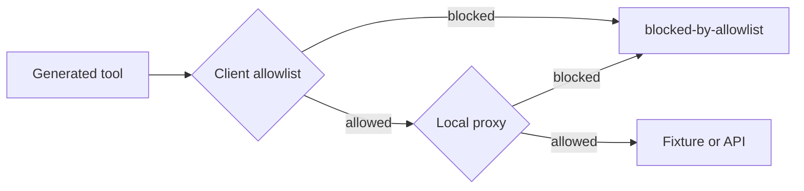
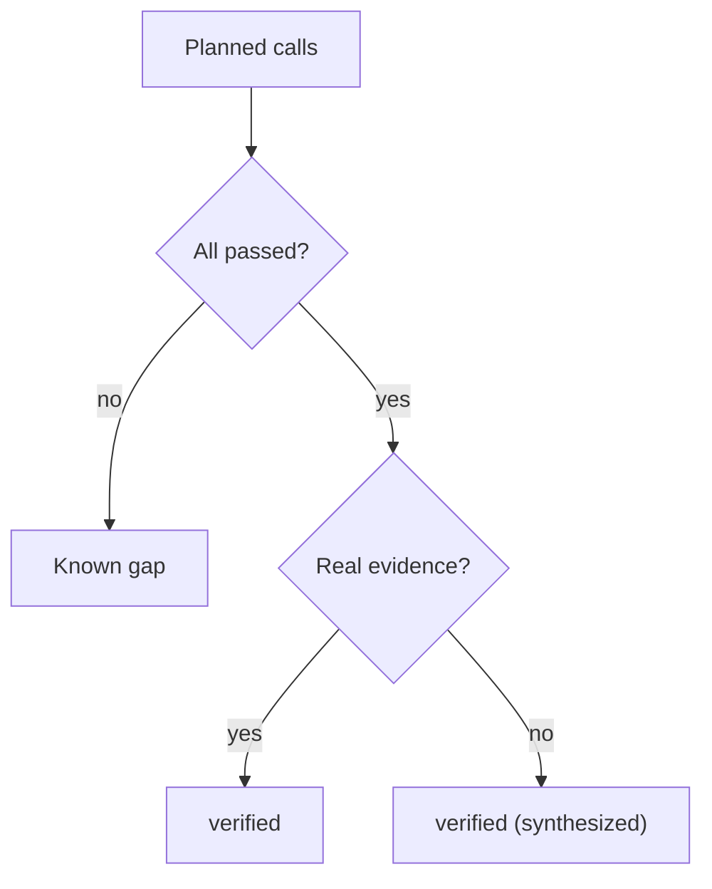

# Methodology

## Curation

Agent mode sends endpoint summaries to Claude and asks for a tool plan, then for each tool's inputs and outputs. The criteria text is the system prompt. Untrusted document text is wrapped in delimiters. After the model replies, the code drops admin, internal, deprecated, webhook-management, and bulk-destructive operations, and any operation whose auth the emitter cannot express. One correction retry is allowed when the plan fails validation. If the token or USD budget is exhausted, the remaining tools come from the heuristic.

USD is estimated from the price table in the curation client.

Heuristic mode builds one tool per endpoint with the same exclusion rules and no model call. Manual mode loads `tools.yaml`, checks it, and applies `overrides.yaml`.

## Verification

Verify emits the server, builds one plan, and calls every tool over stdio. The child process has `PYTHONDONTWRITEBYTECODE` set. Fixture mode replays cassettes through a local server. Recorded cassettes drop request headers, and secret values are replaced before the file is written. `--sandbox` and `--live` dial the named host only when it is loopback or listed in `--allow-host`.

The generated client checks `MCP4API_ALLOWED_HOSTS` before a request. A local proxy checks the same list and records the exchange. A rejected host is `blocked-by-allowlist` and is not dialed.

A call that fails is a known gap. A tool that passed only because the body was synthesized from the schema is still verified, and the report says the evidence was synthesized. A tool skipped by the write guard is not a gap. `--on-failure exclude` leaves the failed tool out of `generated/` and still lists it in `tools.yaml`.

The report fields are the schema in [verification.schema.json](schemas/verification.schema.json).

## Built on

- MCP tool annotations: `readOnlyHint`, `destructiveHint`, `idempotentHint`, `openWorldHint`.
- Agent tool design guidance: one tool per intent, few parameters, hidden plumbing, trimmed outputs.
- JSON Schema 2020-12 as the only schema dialect after ingest.
- Record and replay cassettes for offline verification.
- Seeded property-based example generation with Hypothesis.
- Untrusted-text delimiters, plus exclusion rules enforced in code after the model replies.
